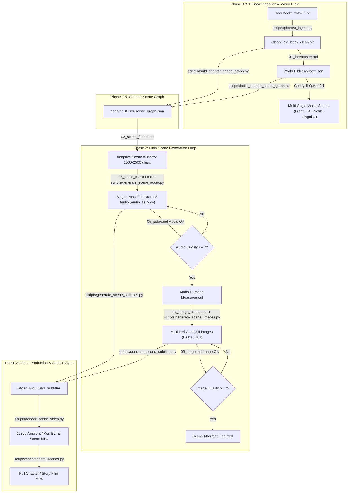

# 🎬 DrST: Autonomous Illustrated Audiobook & Video Pipeline

[](https://www.python.org/)
[](https://github.com/comfyanonymous/ComfyUI)
[](https://github.com/fishaudio/ComfyUI-Drama3)
[](https://qwen.ai/)
[](https://ffmpeg.org/)
[]()

> **DrST** is an autonomous, multi-agent AI pipeline that transforms full-length books and classic novels into richly narrated, visually consistent, 1080p illustrated video books. Designed specifically to operate on consumer hardware (**8 GB VRAM / 32 GB RAM**) using local models—no recurring per-token cloud costs.

---

## 🌟 Key Highlights

* **📖 Whole-Book Continuity & Disambiguation:** Reads the book upfront before generating a single asset. Constructs a structured **World Bible** (`registry.json`) mapping unique entity IDs, resolving naming collisions (e.g. *John Watson* vs. *John Clay*), and maintaining canonical visual descriptions.
* **🎭 360-Degree Multi-Angle Model Sheets:** Generates standardized 4-view character sheets (`front`, `threequarter`, `profile`, `costume_disguise`) and architectural location plates, enforcing facial and outfit lock across all scene beats.
* **🎙️ Expressive Single-Pass Voice Synthesis:** Utilizes **Fish Drama3** (35B Mixture-of-Experts TTS) with MoE weights offloaded to system RAM. Employs prompt KV-history chaining (`history = own[:1] + own[1:][-1:]`) and scoped dramatic cues (`<whisper>...</whisper>`, `[sighs]`) to guarantee zero voice timbre or accent drift across long narrations.
* **🎨 Style-Locked Visual Direction:** Integrates **Qwen-Image 2.1** via ComfyUI to produce coherent illustrations bound to a unified visual identity (*Victorian pastel marker graphic novel on textured paper grain*).
* **⚖️ Multimodal Self-Correction (The Judge Loop):** Employs multimodal evaluation to inspect generated audio waveforms and image renders against strict quality bars (hand anatomy, likeness preservation, prosody), triggering targeted prompt refinements on failure.
* **🎞️ Cinematic Video Engine:** Subtitle generation with Victorian serif typography (`.ass` / `.srt`), ambient blur backgrounds with crisp centered framing, Ken Burns pan/zoom motion, and lossless FFmpeg concatenation.

---

## 🤖 Universal Agent Replication Manual

> [!IMPORTANT]
> **Building or running this pipeline with an autonomous agent?**  
> Read the complete **[AGENT_PIPELINE_SETUP_GUIDE.md](AGENT_PIPELINE_SETUP_GUIDE.md)**.  
> It contains the exhaustive hardware baseline, download links, ComfyUI model placement maps, data schemas, and step-by-step orchestrator protocols needed to replicate the entire studio from scratch on any machine without hardcoded paths.

For design rationale and theoretical background, see **[CONCEPT.md](CONCEPT.md)** and the technical audio guide **[docs/fish_drama3_audio.md](docs/fish_drama3_audio.md)**.

---

## 🏛️ System Architecture



---

## 📁 Repository Structure

```
.
├── config.toml                     # Master pipeline configuration parameters
├── config.example.toml             # Template configuration with placeholder values
├── requirements.txt                # Python environment dependencies
├── README.md                       # Main documentation & quickstart
├── AGENT_PIPELINE_SETUP_GUIDE.md  # Autonomous Agent replication manual
├── CONCEPT.md                      # Architecture design document
├── agents.md                       # Orchestrator state machine instructions
├── agents/                         # Specialist sub-agent prompt specifications
│   ├── 01_loremaster.md            # World Bible extractor & visual baselines
│   ├── 02_scene_finder.md          # Narrative scene boundary detector
│   ├── 03_audio_master.md          # Drama3 acting cues & vocal direction
│   ├── 04_image_creator.md         # Multi-reference ComfyUI prompter
│   └── 05_judge.md                 # Multimodal QA reviewer (audio & vision)
├── scripts/                        # Production execution scripts
│   ├── phase0_ingest.py            # Book cleaner & SVG/image extractor
│   ├── build_chapter_scene_graph.py# Chapter scene graph & model sheet builder
│   ├── generate_scene_audio.py     # Single-pass Drama3 audio generator
│   ├── generate_scene_images.py    # ComfyUI Qwen 2.1 image generator
│   ├── generate_scene_subtitles.py # Victorian styled ASS/SRT generator
│   ├── render_scene_video.py       # 1080p Ambient / Ken Burns video renderer
│   └── concatenate_scenes.py       # Lossless FFmpeg scene stitcher
├── docs/                           # Technical documentation & benchmarks
│   ├── fish_drama3_audio.md        # Drama3 MoE memory & prompt chaining guide
│   ├── qwen_image.md               # Qwen 2.1 ComfyUI parameters
│   ├── test_report.md              # RTX 3060 Ti benchmark report
│   └── audio_consistency_enhancement_plan.md
└── project/
    └── The Return of Sherlock Holmes/ # Included Turnkey Example
        ├── input/
        │   └── The Return of Sherlock Holmes.xhtml
        ├── book_clean.txt          # Cleaned, normalized text ready to run
        ├── project_state.json      # Pipeline state machine cursor
        ├── bible/
        │   ├── registry.json       # Canonical Sherlock Holmes World Bible
        │   └── refs/               # Target directory for model sheets
        ├── illustrations/          # Target for extracted book illustrations
        └── scenes/                 # Target for generated scene assets
```

---

## 🕵️ Included Example: *The Return of Sherlock Holmes*

This repository comes pre-packaged with Arthur Conan Doyle's **The Return of Sherlock Holmes** (Public Domain):
* **Source XHTML:** `project/The Return of Sherlock Holmes/input/The Return of Sherlock Holmes.xhtml`
* **Clean Text:** `project/The Return of Sherlock Holmes/book_clean.txt` (629 KB normalized text)
* **Pre-Built World Bible:** `project/The Return of Sherlock Holmes/bible/registry.json` containing standardized descriptions and model sheet view prompts for Sherlock Holmes, Dr. John Watson, Colonel Sebastian Moran, Inspector Lestrade, 221B Baker Street, and other key entities.

*(Generated audio, video, and scene renders are excluded to keep the repository lightweight and clone-friendly).*

---

## ⚡ Quick Start

### 1. Prerequisites & Dependencies

1. **Python 3.10 – 3.12**
   ```bash
   pip install -r requirements.txt
   ```
2. **FFmpeg** (with `libx264` and `libass` support) must be in your system `PATH`.
3. **ComfyUI** with the [ComfyUI-Drama3](https://github.com/fishaudio/ComfyUI-Drama3) extension installed.

### 2. ComfyUI Model Placement

Place the required quantized checkpoints into your `<COMFYUI_DIR>/models/` directory:
* **Diffusion Models:**
  * `drama3_w4a8experts_bf16.safetensors` in `models/diffusion_models/`
  * `qwen_image_2.1_int8_convrot.safetensors` in `models/diffusion_models/`
* **Audio Codec:**
  * `drama3_codec.safetensors` in `models/vae/`
* **Vision CLIP / Text Encoder:**
  * `qwen3vl_8b_w4a8.safetensors` in `models/clip/`

*(See [AGENT_PIPELINE_SETUP_GUIDE.md Section 4](AGENT_PIPELINE_SETUP_GUIDE.md#4-comfyui--local-ai-model-checkpoints) for detailed setup).*

### 3. Configure the Pipeline

Edit `config.toml` to customize your project settings:
```toml
project_dir = "project/The Return of Sherlock Holmes"
comfy_url = "http://127.0.0.1:8188"
speaker_dynamic = 2
picture_change_time = 10
quality_audio = 7
quality_image = 7
image_style_prompt = "digital art, pastel marker illustration"
```

### 4. Running the Pipeline

You can run individual production scripts or orchestrate the full pipeline via an agent following `agents.md`:

```bash
# Phase 0: Clean and ingest book text
python scripts/phase0_ingest.py --project-dir "project/The Return of Sherlock Holmes"

# Phase 1.5: Build chapter scene graph & model sheets
python scripts/build_chapter_scene_graph.py --chapter 1

# Phase 2: Generate scene audio, images & manifest
python scripts/generate_scene_audio.py --scene-dir "project/The Return of Sherlock Holmes/scenes/scene_0001"
python scripts/generate_scene_images.py --scene-dir "project/The Return of Sherlock Holmes/scenes/scene_0001"

# Phase 3: Generate Victorian subtitles & render scene video
python scripts/generate_scene_subtitles.py --scene-dir "project/The Return of Sherlock Holmes/scenes/scene_0001"
python scripts/render_scene_video.py --scene-dir "project/The Return of Sherlock Holmes/scenes/scene_0001" --layout ambient

# Concatenate all rendered scenes into full chapter movie
python scripts/concatenate_scenes.py --project-dir "project/The Return of Sherlock Holmes"
```

---

## 💻 Hardware Verification & Benchmarks

Tested on a consumer gaming desktop:
* **GPU:** NVIDIA GeForce RTX 3060 Ti (8 GB VRAM)
* **RAM:** 32 GB DDR4
* **OS:** Windows 11 / Ubuntu 22.04 LTS

| Task | Model / Quantization | VRAM Peak | System RAM | Execution Time |
| :--- | :--- | :--- | :--- | :--- |
| **TTS Narration** | Fish Drama3 `w4a8` (Experts in RAM) | 5.8 GB | ~26.4 GB | ~16s / 10s audio |
| **Scene Illustration** | Qwen-Image 2.1 `int8_convrot` (1024x1024) | 6.8 GB | ~14.2 GB | ~52s / frame |
| **Video Rendering** | FFmpeg NVENC (`h264_nvenc`, 1080p30) | < 1.0 GB | < 1.0 GB | ~2.5s / 10s clip |

*(See full benchmark report in [docs/test_report.md](docs/test_report.md)).*

---

## 🤝 Sub-Agent Directory

The pipeline coordinates 5 specialized agent roles:
1. **`01_loremaster.md`**: Builds entity registries, characters, locations, and baseline portraits.
2. **`02_scene_finder.md`**: Slices narrative text into complete dramatic beats using adaptive windows.
3. **`03_audio_master.md`**: Directs Drama3 vocal acting tags and executes single-pass speech synthesis.
4. **`04_image_creator.md`**: Translates scene action into multi-angle ComfyUI prompts with strict style locking.
5. **`05_judge.md`**: Multimodal QA reviewer enforcing hand anatomy, facial likeness, and audio clarity.

---

## 📄 License

This project is licensed under the [MIT License](LICENSE).  
The included text of *The Return of Sherlock Holmes* by Arthur Conan Doyle is in the Public Domain.
