# Implementation Plan: Audio Voice Consistency Enhancement (Fish Drama3)

## Goal Description
During the generation of Scene 1, significant voice consistency issues occurred: vocal pitch, pacing, timbre, and energy drifted noticeably between chunks. An analysis confirmed the root cause: `Drama3Generate.execute()` was called inside a Python `for` loop for each chunk independently. Because Fish Drama3 is an autoregressive model running with `seed=42`, `temperature=1.0`, and `top_p=0.9`, starting on different tokens without preceding audio context caused each chunk to diverge into a different vocal path.

```mermaid
flowchart TD
    subgraph OLD["Old Flawed Workflow (Isolated Chunks)"]
        A1[Scene Text] --> A2[Python Split Chunks]
        A2 --> A3[Loop Chunk 1 -> Drama3Generate]
        A2 --> A4[Loop Chunk 2 -> Drama3Generate]
        A2 --> A5[Loop Chunk N -> Drama3Generate]
        A3 -. No Context .-> A4
        A4 -. No Context .-> A5
        A3 & A4 & A5 --> A6[Manual Silence Stitching]
        A6 --> A7[Heavy Voice Drift & Inconsistency]
    end

    subgraph NEW["New Consistent Workflow (Single-Pass Conditioned)"]
        B1[Full Scene Text] --> B2[Scoped Tags & Clean Anchors]
        B2 --> B3[Single Drama3Generate Call]
        B3 --> B4["Drama3 Internal ~300-byte Chunker<br/>(Chains Chunk 1 + Prior Chunk in KV History)"]
        B4 --> B5["Drama3Decode<br/>(Automatic 0.3s Take Gaps & 0.75s Max Pause)"]
        B5 --> B6[Rock-Solid Voice & Prosody Continuity]
    end
```

This plan modernizes the audio pipeline across all documentation, configuration, agent instructions, and scripts. It transitions audio generation to a **single-pass conditioned generation architecture** leveraging Drama3's built-in ~300-byte chunker and prompt history chaining (`history = own[:1] + own[1:][-1:]`), optimizes sampling parameters for audiobook narration, enforces scoped tags (`<whisper>...</whisper>`), validates reference voice transcripts, and locks the memory profile to `drama3_w4a8experts_bf16` tailored for 32 GB RAM and 8 GB VRAM.



---

## User Review Required

> [!IMPORTANT]
> **No Audio Generation During Execution:**
> Per your instructions, an active project run is in progress. **No TTS audio generation or GPU inference will be executed.** This plan solely updates configuration files, orchestration prompts, agent guidelines, documentation, and creates the clean reusable script `scripts/generate_scene_audio.py` for all future scenes.

> [!IMPORTANT]
> **Hardware Alignment (32 GB RAM / 8 GB VRAM):**
> We strictly retain `drama3_w4a8experts_bf16.safetensors` with `experts="in RAM"` and `expert_cache_gb=0.0`. Higher quantizations (`w6a8` or `int8`) requiring 40–48 GB RAM are explicitly avoided.

> [!WARNING]
> **Tag Syntax Migration:**
> Generic unclosed tags (e.g. `[whispers]` at the start of a chunk) will be formally replaced with scoped XML-style tags (`<whisper>...</whisper>`) and localized point tags (`[sighs]`, `[laughs]`, `[pause]`). This prevents emotional leakage across adjacent text turns.

---

## Open Questions

None currently. The diagnosis from the reference model is sound, fully aligns with `ComfyUI-Drama3`'s internal implementation (`chunking.py`, `prompt.py`, `nodes.py`), and matches the 32 GB RAM hardware boundary.

---

## Proposed Changes

### Configuration Layer

#### [MODIFY] `config.toml`
Add centralized audio hyperparameters so they are no longer hardcoded across ad-hoc scripts:
- `narrator_voice_path`: Explicit path to `project/The Return of Sherlock Holmes/bible/refs/watson_narrator_english.safetensors`.
- `audio_temperature = 0.88`: Sweet spot between dynamic acting (1.0) and voice consistency (0.85).
- `audio_top_p = 0.85`: Tighter candidate sampling without muting pauses.
- `audio_top_k = 0`: Strictly kept at `0` to prevent silence dropouts at pause tokens.
- `audio_max_frames = 600`: Increases chunk headroom to ~28 seconds of audio per internal segment.
- `audio_model_name = "drama3_w4a8experts_bf16.safetensors"`: Explicitly configured for 32 GB RAM.

```toml
# Fish Drama3 Audio Generation Parameters
audio_model_name = "drama3_w4a8experts_bf16.safetensors"
audio_codec_name = "drama3_codec.safetensors"
narrator_voice_path = "project/The Return of Sherlock Holmes/bible/refs/watson_narrator_english.safetensors"
audio_temperature = 0.88
audio_top_p = 0.85
audio_top_k = 0
audio_max_frames = 600
audio_split_long_text = true
```

---

### Shared Audio Engine

#### [NEW] `scripts/generate_scene_audio.py`
Create a centralized, robust scene audio generator script that replaces ad-hoc per-scene scripts.
Key capabilities:
1. **Reads `config.toml`** for all paths, voice references, and hyperparameters.
2. **Strict Voice Reference Validation**: Inspects safetensors metadata and asserts that `metadata["transcript"]` is present and non-empty. Fails early with a clear diagnostic message if corrupted or empty.
3. **Single-Pass Scene Generation**: Formats the scene text with `<|speaker:0|>` prefixes and passes the entire text block to `Drama3Generate.execute()` with `split_long_text=True`.
4. **Native Decode & Pause Formatting**: Uses `Drama3Decode.execute(codec=codec, codes=codes, shorten_long_pauses=True)`.
5. **Clean GPU Memory Management**: Drops model/codec objects and invokes `torch.cuda.empty_cache()` on completion.

---

### Pipeline Orchestration & Agent Instructions

#### [MODIFY] `agents/03_audio_master.md`
- **Revise Step 1 (Text Annotation)**: Mandate scoped emotion tags (`<whisper>...</whisper>`) instead of open prefixes. Restrict unclosed tags.
- **Revise Step 2 (Intelligent Scene Preparation)**: Remove manual text chopping into isolated `.wav` files. Instead, explain how Drama3 handles ~300-byte sub-chunking internally while preserving prompt history.
- **Revise Step 3 (Generation & Judging)**: Specify the single-pass conditioned execution call and holistic whole-scene judging.

#### [MODIFY] `agents/05_judge.md`
- **Update Mode A (Audio Evaluation)**: Evaluate the complete `audio_full.wav` for global vocal consistency (pitch, speed, tone) across the whole scene, along with verbatim word accuracy and absence of glitching.

#### [MODIFY] `agent.md` & `agents.md`
- **Update Phase 2 Step 5 (Generate & Judge Audio)**:
  - Call `03_audio_master.md` to produce `audio_full.wav` in a unified conditioned generation pass.
  - Judge `audio_full.wav` holistically. If retries are needed, adjust seed/temperature or scoped tags in the scene script.

#### [MODIFY] `CONCEPT.md`
- Update Section 1, Section 2, and Section 3 to document the single-pass conditioned voice architecture, scoped tags, and updated sampling defaults.

---

### Reference Documentation

#### [MODIFY] `docs/fish_drama3_audio.md`
Expand the documentation with a full technical guide:
- Why single-pass generation preserves voice identity (`history = own[:1] + own[1:][-1:]`).
- The dangers of `top_k > 0` and `temperature < 0.85` (silent takes).
- Correct tag formatting: `<whisper>...</whisper>` vs `[sighs]`.
- Voice safetensors requirements (matching transcript).
- 32 GB RAM / 8 GB VRAM hardware considerations (`w4a8` with `experts="in RAM"`).

---

## Verification Plan

### Automated / Non-Invasive Verification
1. **Config & Syntax Linting**:
   ```powershell
   python -c "import tomllib; tomllib.load(open('config.toml', 'rb'))"
   ```
2. **Voice Reference Integrity Check**:
   Validate that `watson_narrator_english.safetensors` contains valid codes and a matching English transcript:
   ```powershell
   python -c "
   import safetensors.torch
   with safetensors.safe_open('project/The Return of Sherlock Holmes/bible/refs/watson_narrator_english.safetensors', framework='pt') as f:
       print('Metadata:', f.metadata())
       print('Codes shape:', f.get_tensor('codes').shape)
   "
   ```
3. **Script Compilation & Import Check**:
   Verify `scripts/generate_scene_audio.py` has valid Python syntax without running inference:
   ```powershell
   python -m py_compile scripts/generate_scene_audio.py
   ```

### Manual Verification
1. Review the updated agent prompts (`03_audio_master.md`, `05_judge.md`, `agent.md`, `agents.md`) to confirm that all instructions for vocal direction and chunking are fully unified and consistent with the single-pass architecture.
2. Confirm `config.toml` contains all tuned audio parameters ready for future scene runs.
