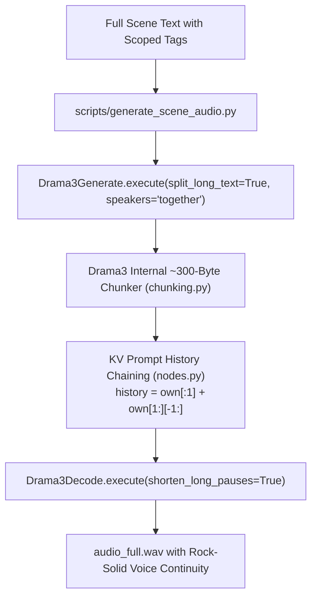

# Fish Drama3 Audio Generation & Voice Consistency Technical Guide

This document defines the technical architecture, memory constraints, and generation best practices for Fish Drama3 in this pipeline.

---

## 1. System Architecture: Single-Pass Conditioned Generation

Fish Drama3 is an autoregressive 35B Mixture-of-Experts (MoE) model. When generating longer text or scene narrations, running independent calls in a Python loop for separate text chunks causes **severe voice timbre, pitch, and accent drift**. Because the model begins afresh with each chunk without preceding audio context, different tokens guide the autoregressive sampler down divergent vocal paths (e.g., swapping Watson's English accent into German or American, or wandering into female registers).

To guarantee absolute vocal continuity across entire scenes, this pipeline uses a **single-pass conditioned architecture**:



### The History Chaining Mechanism
Inside `ComfyUI-Drama3/nodes.py`, when `split_long_text=True`:
1. The text is chunked into natural ~300-byte segments.
2. The initial segment is conditioned on the reference voice tokens (`own[:1]`).
3. For all subsequent segments, Drama3 automatically preserves both the reference voice tokens AND the audio codes of the immediately preceding segment:
   ```python
   history = own[:1] + own[1:][-1:]
   ```
4. This ensures seamless pitch, speed, and vocal timbre continuity across takes.

---

## 2. Hardware Profile: 8 GB VRAM & 32 GB RAM

On an RTX 3060 Ti (8 GB VRAM) and 32 GB System RAM:
- **Model Quantization:** Strictly use `drama3_w4a8experts_bf16.safetensors` (~24.6 GB).
- **Expert Offloading:** `experts = "in RAM"`, `expert_cache_gb = 0.0`.
  The active attention backbone runs on the GPU (~5.5–6.5 GB VRAM), while MoE expert weights remain in system RAM and stream dynamically.
- **Do NOT load ASR:** `qwen3_asr_1.7b_bf16.safetensors` must remain disabled to avoid exceeding the 32 GB RAM budget.
- **Do NOT use higher quantizations:** `w6a8` or unquantized BF16 require 40–48+ GB RAM and will trigger Windows paging file thrashing or Out-of-Memory crashes.
- **VRAM Contention with ComfyUI / Qwen 2.1:**
  Before running Drama3 TTS, always unload active image generation models from VRAM by calling:
  `POST http://127.0.0.1:8188/free` with payload `{"unload_models": true, "free_memory": true}`.

---

## 3. Sampling Parameters & Audio Hyperparameters

Configured in `config.toml`:

| Parameter | Recommended Value | Technical Reason |
| :--- | :--- | :--- |
| `audio_temperature` | `0.88` | Sweet spot between vocal expressiveness (1.0) and stability/continuity (0.85). Avoid values below 0.82 (robotic monotone) or above 1.05 (vocal cracking). |
| `audio_top_p` | `0.85` | Restricts sampling to high-probability tokens, removing unnatural inflection artifacts. |
| `audio_top_k` | `0` | **Crucial:** Must be strictly `0`. Setting `top_k > 0` truncates pause tokens and causes complete silence dropouts during breath intervals. |
| `audio_max_frames` | `600` | Headroom for ~28 seconds of audio per internal segment, preventing premature cutoffs. |
| `audio_split_long_text`| `true` | Enables Drama3's internal ~300-byte chunker and prompt chaining. |

---

## 4. Voice References & Safetensors Requirements

Voice clones are stored as `.safetensors` files in `project/<Book Name>/bible/refs/`.

### Mandatory Metadata & Shape
A valid Drama3 voice reference file must contain:
1. `codes` tensor: A quantized acoustic code tensor (shape `[10, N]` where $N$ is sequence length).
2. `metadata["transcript"]`: The exact English transcription of the spoken reference audio.

> [!CAUTION]
> If `metadata["transcript"]` is empty or mismatches the reference audio language, the model will hallucinate phonemes and drift into foreign accents or gibberish.

The pipeline voice for Dr. John Watson (narrator) is:
`project/The Return of Sherlock Holmes/bible/refs/watson_narrator_english.safetensors`
- Validated codes shape: `[10, 119]`
- Validated transcript: *"In the year 1894 the whole of civilized Europe was astonished by the tragedy in the Park Lane mystery."*

---

## 5. Vocal Direction & Tag Syntax Rules

Drama3 supports localized emotion and prosody tags. To prevent emotional leakage across sentences, tags must follow these rules:

### A. Scoped XML Tags (Preferred for Spans)
Wrap specific clauses or sentences inside scoped tags:
- `<whisper>text</whisper>`: Low-volume, conspiratorial delivery.
- `<excited>text</excited>`: Dynamic, energetic delivery.
- `<shouting>text</shouting>`: Loud projection.

### B. Point Event Tags (Preferred for Punctuation/Gaps)
Place at natural narrative breath points:
- `[pause]`: Introduces an explicit 0.3s–0.75s dramatic pause.
- `[sighs]`: Gentle exhalation.
- `[laughs]`: Short chuckle.

### C. Anti-Patterns (Strictly Avoid)
- **Never use unclosed tags:** Do NOT write `[whispers] It was a dark night...` at the start of a paragraph, as the whisper tone will bleed uncontrollably into subsequent sentences.
- **Never alter the author's prose:** Injected tags must not replace or mutate original words.
- **Never read visual anchors:** Visual markers like `[ILLUSTRATION: ...]` must be stripped before TTS ingestion.

---

## 6. Execution via `scripts/generate_scene_audio.py`

The canonical script executes the unified pipeline:
```powershell
& "C:\comfyui\ComfyUI_windows_portable\python_embeded\python.exe" scripts/generate_scene_audio.py `
  --text "Your formatted scene text here" `
  --output "project/The Return of Sherlock Holmes/scenes/scene_XXXX/audio_full.wav"
```
Or pointing directly to a text file:
```powershell
& "C:\comfyui\ComfyUI_windows_portable\python_embeded\python.exe" scripts/generate_scene_audio.py `
  --text-file "path/to/scene_text.txt" `
  --output "path/to/audio_full.wav"
```
The script automatically reads `config.toml`, loads `watson_narrator_english.safetensors`, invokes single-pass generation with history chaining, decodes with natural pause shortening, saves `audio_full.wav`, and frees GPU memory.
